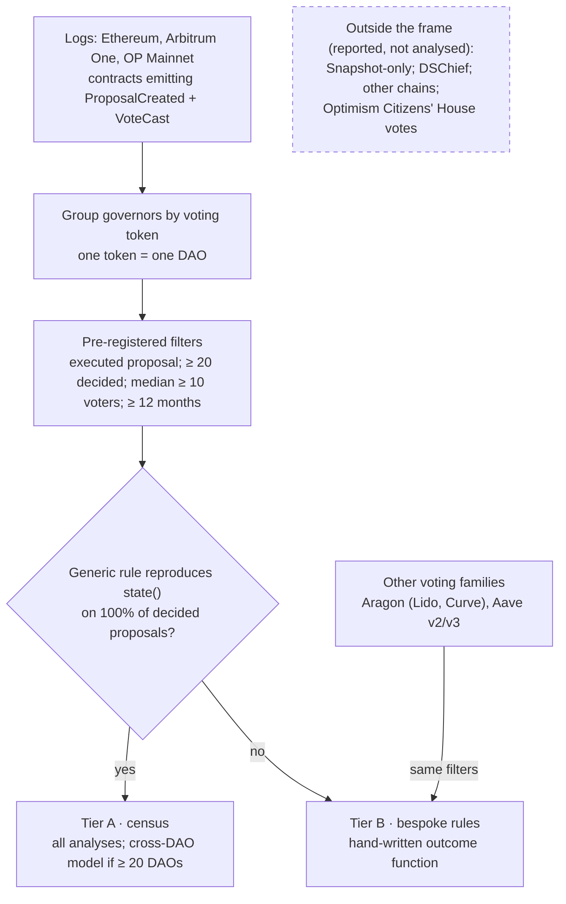
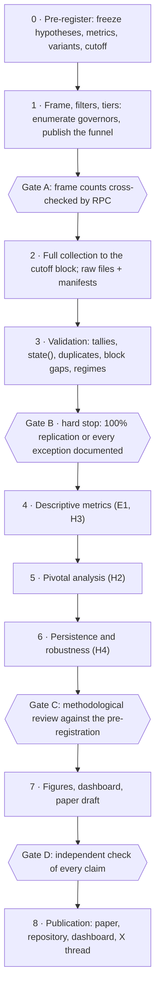

# H Naught Research 001 — Research Design: How Concentrated Is DAO Voting Power?

Version 1 · 2026-11-21 · H Naught Research

**Recommendation:** the first publication should measure concentration of *exercised* voting power and counterfactual outcome sensitivity for every DAO that passes a pre-registered selection procedure. The frame is every governance contract found in chain logs on Ethereum, Arbitrum One and OP Mainnet. Tier A is a census of standard Governor DAOs; Tier B covers DAOs with bespoke rules (Section 3). No DAO is included by name. The Snapshot layer is a follow-up study.

This is the stage-1 deliverable only. Nothing has been downloaded or analysed yet. Every source fact below comes from documentation or pages fetched on 2026-11-21; anything not yet confirmed against a live API or contract is marked **\[verify\]**. No findings are stated or implied.

## 1. Critical assessment of the research question

The question is worth asking, but as written it mixes one directly observable quantity with several that public data can only bound. The study should be built on the observable layer and say plainly what it cannot see.

### 1.1 The five concepts, and what public data supports

| Layer | What it is | Public observability | Role in MVP |
| --- | --- | --- | --- |
| 1. Token ownership | Balances per address | Observable (Transfer events), but polluted by exchanges, bridges, LPs, vesting and treasury contracts | Out of scope |
| 2. Delegated voting power | `getVotes` / checkpoints per delegate at a block | Observable (DelegateVotesChanged events) | Denominator for turnout only |
| 3. Exercised voting power | Weight attached to each recorded vote | Directly observable (VoteCast events) | **Primary object** |
| 4. Outcome influence | Whether a vote, or set of votes, is decisive under the actual rule | Computable, but only as a mechanical counterfactual | **Primary object** |
| 5. Beneficial control | Which person or organisation controls an address | Not observable without off-chain identity data | Excluded; bounded analytically (1.3) |

In delegation-based Governor DAOs, layers 2 and 3 are linked by design: the voting address is usually a *delegate*, not a holder. A single delegate address can represent thousands of holders. So address-level concentration of exercised power is **not** a statement about wealth concentration.

### 1.2 Ambiguities to resolve before data collection

- **"Effective" voting power.** Pick one operational meaning. Proposed: weight actually cast on a proposal (layer 3). "Effective number" is reserved for the HHI-based N\_eff (Section 5).
- **Population.** "Among participating addresses" makes every measure conditional on turnout. That conditioning is legitimate, but it must be stated, and turnout must be reported next to every concentration figure.
- **Aggregation level.** Pooling all votes in a period weights an address by how often it votes, which is a different quantity from per-proposal concentration. Proposal is the primary unit; period figures are summaries (median, IQR) of proposal-level values.
- **"Major" DAOs.** Results generalise at most to large, delegation-based token-voting DAOs on Ethereum/L2s. They say nothing about DAOs in general.

### 1.3 What can be said about beneficial control without identifying anyone

Two inequalities let us bound entity-level concentration without inferring identities. If the true entity partition is a coarsening of the address partition (several addresses may belong to one entity):

- Merging addresses never lowers HHI, because (a + b)² ≥ a² + b².
- Merging never lowers any top-k share.

So address-level HHI and top-k shares are **lower bounds** on concentration by controlling entity. They are not bounds for Gini, which can move either way under merging. In the other direction, a delegate pools many holders, so address-level figures *overstate* concentration of underlying ownership. The paper should state both directions.

### 1.4 Prior work the study must position against

- [Fritsch, Müller & Wattenhofer, *Analyzing voting power in decentralized governance: Who controls DAOs?*](https://arxiv.org/abs/2204.01176) studies Compound, Uniswap and ENS with holder, delegate, proposal and vote data. It was published in *Blockchain: Research and Applications* 5(3), Sept 2024. Our sample overlaps it, so novelty must come from rule-exact pivotal analysis, a longer window, Arbitrum, and pre-registered methods.
- [Feichtinger, Fritsch, Vonlanthen & Wattenhofer, *The Hidden Shortcomings of (D)AOs*](https://arxiv.org/abs/2302.12125) covers 21 on-chain DAOs and reports high concentration in most of them.
- [Kitzler et al., *The Governance of DAOs: contributors' influence…*](https://arxiv.org/abs/2309.14232) studies contributor influence and reports cases where contributors decided proposals alone.

Implication: "voting power is concentrated" is not a new finding. The contribution has to be methodological rigour and the *outcome-sensitivity* layer, done under each DAO's exact counting rules.

## 2. Revised testable hypotheses

H1 and H3 as originally written are not falsifiable without arbitrary thresholds. The proposal is to recast them as **pre-registered estimands**: we commit in advance to the quantities and how they are reported, not to a cut-off. H2 and H4 can be kept as hypotheses with clear nulls.

### H1 → E1: Level of exercised concentration (descriptive)

- **Problem with the original.** "Disproportionately large" is true by construction for any unequal distribution. Its only reference point is perfect equality, which no token-weighted system aims for.
- **Estimand.** For each DAO and governor, the distribution across proposals of N\_eff, top-1/5/10 share, and the minimum-majority coalition (MMC: the fewest addresses whose cast weight exceeds 50% of the total).
- **Unit.** Proposal (closed, non-cancelled, at least 1 vote).
- **Report.** Median and IQR per DAO and per year. No significance test, because there is no meaningful null.
- **Interpretation criterion.** None set in advance. Figures are reported against turnout and quorum so readers can judge them.

### H2: Outcome dependence on the largest voters

- **Unit.** Proposal with a determinate vote outcome (Succeeded or Defeated as computed by the contract).
- **Primary variable.** k\* = the smallest k such that removing the k largest-weight votes (all other recorded votes fixed) changes the vote status. k\* = ∞ if no removal flips it. Section 6 gives the full definition.
- **Hypothesis, as a stated estimate.** H2a: the share of proposals with k\* ≤ 1 is above zero in every DAO. H2b: the dominant flip mechanism is quorum failure, not a majority reversal.
- **Why no null-hypothesis test.** We observe every proposal, so the share is a population quantity for the window. A Wilson interval is reported only under an explicit superpopulation reading (Section 5.6).
- **Limitation.** This is a mechanical counterfactual. It ignores behavioural response, such as other delegates mobilising if a large one abstained.

### H3: Cross-DAO differences (testable on Tier A if it holds at least 20 DAOs)

- **What changed.** With a census of Tier A instead of 4–6 hand-picked DAOs, the DAO becomes a sampled unit. Cross-DAO variation can be estimated rather than only described.
- **Model.** A proposal-level mixed model: log N\_eff \~ log(voters) + turnout/quorum + (1 | DAO). Covariates are fixed before data collection.
- **H0.** The between-DAO variance component is zero once participation is conditioned on. **H1:** it is positive.
- **Test.** Likelihood-ratio test of the random effect. The null sits on the boundary of the parameter space, so the reference distribution is a 50:50 mixture of χ²₀ and χ²₁, checked by parametric bootstrap. Effect size: the intraclass correlation (ICC) with a cluster-bootstrap interval.
- **Design associations (exploratory, not causal).** DAO-level covariates such as quorum basis, quorum relative to delegated supply, L1 vs L2, age and governor family. Reported as associations with intervals. No causal language, because design is not randomly assigned.
- **Fallback.** If Tier A has fewer than 20 DAOs, H3 reverts to a descriptive comparison with effect sizes, as in the earlier draft. That threshold is pre-registered.
- **Tier B DAOs** are compared descriptively against the Tier A distribution and are not pooled into the model.

### H4: Persistence of the largest voting addresses

- **Unit.** Pair of consecutive calendar quarters within a DAO (quarters with at least 3 proposals).
- **Variables.** Jaccard overlap of the top-10 sets by cast weight; retention rate of the top-10; Spearman correlation of shares among addresses active in both quarters.
- **H0.** Top-10 membership is no more persistent than under random reshuffling of addresses within the active set of each quarter (permutation null).
- **H1.** Observed overlap exceeds the permutation distribution.
- **Caveat.** Rejecting this null is very likely and not very informative. The useful output is the *magnitude* of persistence and how it changes over time. Address rotation by the same entity biases persistence downward.

### Not testable with public data in this study

- Concentration of **beneficial or organisational control** (layer 5). It can only be bounded (Section 1.3).
- Any claim of **coordination, collusion or capture**. Correlated votes are not evidence of coordination when most proposals pass near-unanimously.
- **Causal effects** of governance design on concentration, because there are too few DAOs and no exogenous variation.

## 3. Sampling frame and DAO selection (revised 2026-11-21)

**The sample is no longer hand-picked.** Every DAO enters by a procedure anyone can rerun. The procedure has three steps. First, enumerate all governance contracts from chain logs. Second, group them into DAOs and apply pre-registered filters. Third, split the survivors into a census tier (A) and a bespoke-rules tier (B). DAOs named in earlier drafts are *expected* to pass, but none is included by name.



All Governor-family DAOs that pass the filters are analysed. Only DAOs whose rules the generic outcome function cannot reproduce need hand-written work.

### 3.1 Unit: what counts as one DAO

A DAO is the set of governor contracts that share one voting token. The token is read from the contract: `token()` on OZ governors; on Bravo forks the getter name varies (`comp()`, `uni()`, …) and is resolved per contract **\[verify\]**. This merges migrations (Alpha → Bravo → upgraded governor) and parallel governors (Arbitrum Core + Treasury; ZKsync × 3) automatically.

### 3.2 Frame: enumeration from logs

- **Chains in scope:** Ethereum, Arbitrum One, OP Mainnet. ZKsync Era is added if an RPC topic scan is feasible **\[verify\]**. Other chains are out of scope and listed as a limitation.
- **Governor family:** every contract that emitted both `ProposalCreated` (topic0 `0x7d84a626…bd5e0`) and `VoteCast` (`0xb8e13888…ddda4`) or `VoteCastWithParams` (`0xe2babfba…b8712`). Bravo and OZ use identical signatures for these events (keccak computed locally; Uniswap's Bravo emits `0x7d84…` per [Etherscan](https://etherscan.io/tx/0x5cc7d736298232d1a97e315c990058016a0f7297cb11d19d6a3ed339207f7171)), so one query covers both.
- **Other families:** enumerated by their own event signatures. That means Aragon Voting (`StartVote`, `CastVote`) and Aave Governance v2/v3 (`VoteEmitted`). Topics **\[verify\]**.
- **Source:** [BigQuery public blockchain datasets](https://docs.cloud.google.com/blockchain-analytics/docs/supported-datasets) for Ethereum, Arbitrum and Optimism. Arbitrum and Optimism are in Preview, so completeness is cross-checked by RPC for every included DAO. The [older shared listings stop updating after 2026-10-31](https://docs.cloud.google.com/blockchain-analytics/docs/schema); use the `bigquery-public-data.goog_blockchain_*` tables. Queries are billed by bytes scanned, so cost is estimated before running.

### 3.3 Filters (pre-registered, applied mechanically, in order)

1. **Binding:** at least one `ProposalExecuted` event from the DAO's governors. Proposals after a publicly documented move of execution off the governor are excluded; for example, Gitcoin moved treasury execution to a multisig in 2026 ([Tally](https://tally.xyz/gov/gitcoin/proposal/57072833898817791797073691509906632211867496916826813977377920660331579547554)). Every such case goes in an exceptions log with its source.
2. **Activity:** at least 20 decided proposals (Succeeded or Defeated by `state()`; cancelled excluded). 20 is roughly the smallest number for which per-DAO quartiles are meaningful. Sensitivity runs at 10 and 40.
3. **Breadth:** median of at least 10 voters per decided proposal. This removes test, team-only and spam governors. Sensitivity runs at 5 and 25.
4. **History:** first and last decided proposals at least 12 months apart, so H4 (persistence over time) is estimable.

The paper reports the full funnel: contracts found → DAOs → count after each filter → Tier A / Tier B. None of these counts is known yet.

### 3.4 Tiers

- **Tier A (census).** Every Governor-family DAO that passes the filters *and* whose recorded outcomes are reproduced on 100% of decided proposals by the generic outcome function. That function reads the counting rule from `COUNTING_MODE()` on OZ (e.g. `quorum=for,abstain`), or applies the Bravo rule with `quorumVotes()`. Quorum is read from the contract at the snapshot block. All analyses run on Tier A.
- **Tier B (bespoke rules).** DAOs that pass the filters but fail generic replication (custom governors), plus all passing DAOs from other families (Aragon, Aave). Each gets a hand-written outcome function, validated the same way. If Tier B has more than 6 DAOs, a seeded random draw stratified by family picks 6, and the rest are listed.
- **Expected placement, to be checked rather than assumed:** Uniswap, ENS, Compound, ZKsync → A. Arbitrum → A or B. Optimism (proposal types, approval and optimistic modules) → B. Lido, Curve, Aave → B.

### 3.5 Outside the frame (reported, not analysed)

- Snapshot-only governance, and Sky/Maker DSChief (continuous approval, no per-proposal outcome).
- Chains outside scope, and non-EVM governance.
- Optimism Citizens' House votes (one person, one vote; the house was [paused indefinitely on 2026-06-03](https://gov.optimism.io/t/governance-update-12/10697)). Only Token House votes are used. Before the pause, citizen vetoes are recorded as post-vote events.

### 3.6 Bias that remains

The frame sees only standard event families on three or four chains. DAOs with custom events, other chains or off-chain voting are invisible. The filters favour active, long-lived DAOs. Results generalise to *active on-chain token-voting DAOs on these chains*, which is still narrower than "DAOs".

## 4. Verified data sources and limitations

Primary source of truth: **on-chain event logs and contract view calls.** Third-party APIs are used only to cross-check, never as the only source of a number. Collection date for all checks below: 2026-11-21.

| Source | Access & auth | Rate limit (documented) | Coverage | Fields we need | Limitations |
| --- | --- | --- | --- | --- | --- |
| **Governor event logs** via Ethereum / Arbitrum One JSON-RPC (`eth_getLogs`) | RPC provider; archive node needed for historical `eth_call` | Provider-specific; log-range caps per call **\[verify chosen provider\]** | Full history from each governor's deployment | `ProposalCreated`, `VoteCast(voter, proposalId, support, weight, reason)`, `VoteCastWithParams` (OZ), `ProposalCanceled/Queued/Executed` | Event signatures differ between Bravo and OZ; fractional / split votes must be detected; RPC log limits require chunking |
| **Contract view calls** at proposal blocks | Archive RPC | Provider-specific | Any past block | `quorum(blockNumber)` (OZ), `quorumVotes()` (Bravo), `proposalVotes`/`proposals(id)` tallies, `state(id)`, `getVotes(addr, block)` | The validation ground truth; must be called at the right block for supply-indexed quorums |
| **Aragon Voting events** (Lido) | Archive RPC | Provider-specific | Full history | `StartVote`, `CastVote(voteId, voter, supports, stake)`, `ExecuteVote`; delegate-cast events **\[verify\]** | Separate decoder; objection phase allows Yes → No changes, so use the final state per voter |
| **[Tally API](https://docs.tally.xyz/tally-features/welcome)** (GraphQL, `https://api.tally.xyz/query`) | Free API key from Tally settings, `Api-Key` header | \~1 request/second on the free tier | Governor DAOs indexed by Tally | Proposals, votes, delegates, governor metadata | Open beta; undocumented playground endpoints may change without notice; a third-party index, so cross-check only. Tally announced its wind-down on 2026-03-17 and ScopeLift took over operations, with a rebrand pending, so API continuity is uncertain **\[verify\]** |
| **[Snapshot Hub GraphQL](https://docs.snapshot.box/tools/api)** (`https://hub.snapshot.org/graphql`) | No key needed; optional key via `x-api-key` header | 100 requests/min without key; 2M requests/month with key ([api-keys](https://github.com/snapshot-labs/snapshot-docs/blob/master/tools/api/api-keys.md)) | All Snapshot spaces | `votes`: `voter`, `vp`, `vp_by_strategy`, `vp_state`, `choice`, `created`; `proposals`: `scores`, `scores_total`, `state`, `snapshot`, `strategies` | Follow-up study only. Page size: community code uses `first: 1000`, but no documented maximum **\[verify\]**. Quorum appears in space settings in the docs, not as a confirmed proposal field **\[verify via schema introspection\]**. `vp` is computed by the hub from strategies, so independent verification means re-running strategies |
| **Governance documentation and forums** (links in Section 3) | Public | — | Rule text and dated changes | Quorum, thresholds, counting, voting periods | Docs can lag contracts; contracts win any conflict |

The revised sample needs two more decoders, both read from contracts as above. **Optimism:** the Agora governor proxy on OP Mainnet ([walkthrough](https://github.com/defi-wonderland/handbook/blob/main/sites/optimism/docs/governance/governor-walkthrough.md)), its ProposalTypesConfigurator and VotableSupplyOracle, and Alligator subdelegation events. **Aave:** Governance v2 events on Ethereum for the pre-v3 history, then v3 VotingMachine events on each voting network named per proposal ([docs](https://docs.aave.com/governance/master/aave-governance-v3)). Both are **\[verify in Stage 1\]**.

**Frame enumeration** uses the [BigQuery public blockchain datasets](https://docs.cloud.google.com/blockchain-analytics/docs/supported-datasets) (Ethereum; Arbitrum and Optimism in Preview). Access is through a Google Cloud project, billed per bytes scanned, and the query text is committed to the repository. The BigQuery frame is only an index: every vote used in analysis is re-extracted by RPC and validated against the contract.

### 4.1 Pipeline design (reproducible, raw kept separate from processed)

1. **Configure.** `config/daos.yaml` holds each governor address, chain, deployment block, event ABI, counting rule ID and a fixed **cutoff block** per chain (proposed cutoff: last block of 2026-10-31 UTC). The cutoff is frozen, so reruns give identical data.
2. **Extract** (`src/collect/`). Chunked `eth_getLogs` by block range, with retries. Raw JSON responses are written as-is to `data/raw/<dao>/<governor>/<from>-<to>.jsonl.gz`, together with a manifest of RPC endpoint, chain ID, block range, row count, SHA-256 and timestamp. Raw files are never edited.
3. **Snapshot state.** For each proposal, call `quorum`, the tallies and `state` at the relevant blocks, and store them raw.
4. **Decode and normalise** (`src/process/`) into Parquet tables: `proposals`, `votes`, `rules` (one row per DAO × rule regime with validity block range) and `events`.
5. **Validate** (`src/validate/`; hard gate, Section 10). Recomputed For/Against/Abstain must equal contract tallies exactly. The recomputed outcome must equal `state()`. There must be one vote per (proposal, voter). Weights must be ≥ 0, and decoded proposal counts must match the contract's proposal count.
6. **Record** the dependency lockfile, git commit hash and data manifest hash in every output figure and table.

### 4.2 Checks required by the brief

Missing records (block-range gaps in the manifest), duplicate votes (same tx log twice; Bravo forbids a voter voting twice), invalid weights (zero-weight votes are kept but flagged), cancelled proposals (excluded from outcome analysis, counted separately), governor migrations (each governor is its own stream with an explicit regime ID), and rule changes (the `rules` table with block validity, cross-checked against contract calls).

## 5. Concentration metrics comparison

Primary metrics: **N\_eff = 1/HHI**, **top-k shares** and the **minimum-majority coalition (MMC)**. Gini is secondary, because it is dominated by the number of tiny voters, and that number depends on gas costs and UI rather than on power.

Notation: on one proposal, voter i casts weight w\_i ≥ 0, W = Σ w\_i, share s\_i = w\_i / W, n = number of voters, and w\_(1) ≥ w\_(2) ≥ … is the sorted order.

| Metric | Definition | Answers | Effect of adding many dust voters | Under merging of addresses | Use |
| --- | --- | --- | --- | --- | --- |
| Top-k share | Σ of the k largest s\_i | How much the largest k hold | Barely changes | Never decreases | Primary (k = 1, 5, 10) |
| MMC | min m with Σ of the m largest s > 0.5 | How few addresses form a majority of cast weight | Barely changes | Never increases | Primary; intuitive for X posts |
| HHI | Σ s\_i² | Probability two random units of weight belong to the same address | Barely changes | Never decreases | Primary via N\_eff |
| N\_eff | 1 / HHI | "Equivalent number of equal voters" | Barely changes | Never increases | Primary headline |
| Gini | Σ\_i Σ\_j \|w\_i − w\_j\| / (2 n² ȳ) | Inequality across all voters | Rises sharply towards 1 | Ambiguous | Secondary, with a weight-floor sensitivity check |
| Hill numbers ᵠD | (Σ s\_i^q)^{1/(1−q)} | A family indexed by q: q = 0 counts voters, q = 1 is exp(Shannon entropy), q = 2 is N\_eff, q = ∞ is 1/max s | Depends on q | — | Robustness: one curve shows all |

### 5.1 The formulas

```latex
G = \frac{\sum_{i=1}^{n}\sum_{j=1}^{n} |w_i - w_j|}{2 n^2 \bar{w}} = \frac{2\sum_{i=1}^{n} i\, w_{[i]}}{n \sum_i w_i} - \frac{n+1}{n}\quad (w_{[i]}\text{ ascending})
```

```latex
HHI = \sum_{i=1}^{n} s_i^2, \qquad N_{\text{eff}} = \frac{1}{HHI}, \qquad {}^{q}D = \Big(\sum_i s_i^{\,q}\Big)^{1/(1-q)}
```

Gini under k added zero-weight voters has a closed form, which is the core argument for demoting it:

```latex
G' = \frac{nG + k}{n + k}
```

HHI is unchanged by zero-weight voters, because shares do not move.

### 5.2 Worked example (checked in Python)

Six voters with weights 50, 20, 10, 10, 5, 5 (W = 100).

- Top-1 = 50%. MMC = 2, because 50% alone is not more than 50%.
- HHI = 0.25 + 0.04 + 0.01 + 0.01 + 0.0025 + 0.0025 = 0.315, so N\_eff ≈ 3.17. Exp(Shannon) ≈ 4.17.
- Gini = 0.45.
- Add 94 voters with weight 0 (or dust). Gini becomes (6 × 0.45 + 94)/100 = 0.967. HHI, N\_eff, top-k and MMC do not change.

So a DAO with cheap gasless voting can look far more unequal by Gini than an otherwise identical DAO on expensive L1, with exactly the same power structure.

### 5.3 What HHI / N\_eff show that Gini does not

Gini measures *inequality*, meaning dispersion relative to the mean. HHI measures *concentration*, meaning how much weight sits with few units. Ten equal whales and one million dust voters give Gini near 1 but N\_eff near 10. For a question about who decides, N\_eff is the more relevant reading.

### 5.4 Assumptions and common mistakes

- Comparing Gini across systems with different participation floors. That is a mistake.
- Pooling votes over a period, then computing one Gini. This silently weights by frequency of voting.
- Treating N\_eff as a count of *people*. It is a count of equal-weight *addresses*, and it is a lower bound on entity-level concentration only for HHI and top-k (Section 1.3).
- Mixing denominators. Share of *cast* weight, share of *delegated* weight and share of *supply* are three different numbers. Every chart labels which one it uses.
- Including Abstain weight. Primary metrics use all cast weight (For + Against + Abstain). A sensitivity check uses For + Against only.

### 5.5 Prerequisites to refresh

Lorenz curves and majorisation (why Gini and HHI can rank two distributions differently); Schur-convexity (why HHI never decreases under merging); bootstrap theory, especially the exchangeability assumption and block bootstrap for dependent data; and permutation tests.

### 5.6 Statistical uncertainty: when intervals mean something

- The data are the **complete population** of votes for the window. For "what happened in these proposals" there is no sampling error, and no confidence interval is reported.
- Intervals are reported only for a stated **superpopulation** question: what a typical proposal from this DAO's process looks like. Then the proposal is the resampled unit.
- Proposals are not independent: they share voters, cluster in time and track rule regimes. Use a **moving-block bootstrap over proposals ordered by time**, block length about one quarter, within each DAO and rule regime. Report sensitivity to block length.
- Cluster bootstrap *by DAO* is used only for Tier A cross-DAO estimates when Tier A has at least 20 DAOs. Below that, cross-DAO results stay descriptive.
- Robustness set: an alternative metric (Hill-number curve); excluding proposals in the top 1% by turnout; For + Against-only weights; dropping proposals with fewer than 10 voters; and splitting each DAO by rule regime.

## 6. Measuring pivotal voting influence

Method: a **rule-exact counterfactual removal analysis**. Each proposal's outcome is recomputed under its own DAO's counting function. The k largest recorded votes are deleted, and we check whether the status changes. It is labelled everywhere as a *counterfactual sensitivity analysis*, never as evidence that an address caused an outcome.

### 6.1 Outcome function per rule regime

Each regime gets a pure function `outcome(For, Against, Abstain, Q) → {pass, fail_quorum, fail_majority}`, with Q read from the contract at the proposal's snapshot block:

- **Bravo family (Tier A, generic):** pass iff For > Against and For ≥ Q.
- **OZ family (Tier A, generic; rule read from COUNTING\_MODE()), e.g. for quorum=for,abstain:** pass iff For > Against and For + Abstain ≥ Q(snapshot block).
- **Aragon (Lido):** pass iff Yes ≥ 5% of supply at the snapshot block and Yes / (Yes + No) > 50%, evaluated at the end of the objection phase.
- **Optimism (Agora): pass iff the quorum and approval threshold of the proposal's type are both met; counting basis \[verify\]. Aave: pass iff YES ≥ quorum and YES − NO ≥ differential, both from the proposal's access level. Any other custom governor (Tier B):** taken from the deployed contract source **\[verify\]**.

The gate before any counterfactual: `outcome(observed tallies)` must reproduce the contract's `state()` for 100% of proposals. Every exception is listed and explained.

### 6.2 Definitions

Order votes by weight w\_(1) ≥ w\_(2) ≥ …, across all sides. Let O\_k be the outcome after removing the top k.

- **k\*** = min { k ≥ 1 : status(O\_k) ≠ status(O\_0) }, with ∞ if none. "Status" is pass/fail.
- **Flip mechanism.** Quorum (the remaining total falls below Q), majority (the For/Against ordering reverses), or both.
- **Side-specific variants.** k\*\_win removes only votes on the winning side. This is the cleanest "dependence on the largest supporters" measure, and it is pre-registered as the primary variant. k\*\_all removes from all sides and is secondary.
- **Margins.** Quorum margin = (counted total − Q)/Q and majority margin = (For − Against)/cast. These are reported alongside, because k\* is a coarse integer.
- **Single-voter pivotality.** π\_i = 1 if removing voter i alone flips the status. Count the pivotal voters per proposal, and the proposals with at least one.

Example: Q = 40, For = {A: 30, B: 15, C: 5}, Against = {D: 10}. The proposal passes (50 ≥ 40 and 50 > 10). Removing A gives For = 20 < 40, a quorum fail, so k\*\_win = 1 with a quorum mechanism. Majority was never at risk. This is the pattern expected to dominate: most DAO proposals are lopsided, so pivotality runs mainly through quorum.

### 6.3 What is explicitly *not* modelled

- Behavioural response. In reality others may vote if a whale does not.
- Vote *flipping* (moving a large vote to the other side). Reported as a secondary counterfactual, k\*\_flip, because it is a different question.
- Post-vote stages: timelock, cancellation, Security Council or dual-governance veto. Recorded as observed states, never counterfactualised.
- A priori power indices (Banzhaf, Shapley–Shubik). These assume random voting, which does not fit near-unanimous DAO votes. They are a possible appendix, not the MVP.

### 6.4 Executable status

"Executable" here means the vote-stage status (Succeeded or Defeated). Whether a succeeded proposal was later queued and executed is reported descriptively from events. It is not part of k\*.

## 7. Methodological risks and confounding factors

The largest risk is interpretive: readers will treat address concentration as people or wealth concentration. The second is technical: mis-encoding a quorum rule makes every pivotal result wrong.

| Risk | Effect on results | Mitigation |
| --- | --- | --- |
| Delegation pools many holders behind one address | Overstates holder-level concentration | State the denominator on every chart; never write "whales own" |
| Unknown common control across addresses | Understates entity-level concentration | Present address-level HHI and top-k as lower bounds (Section 1.3); no clustering heuristics |
| Quorum rule mis-encoded (For-only vs For + Abstain; supply-indexed Q) | Wrong k\* everywhere | Read Q from the contract at the snapshot block; 100% `state()` replication gate |
| Rule regime changes (Arbitrum 2025 and 2026; Compound 2025; Uniswap thresholds) | Spurious trends over time | `rules` table with block validity; split time series at regime breaks |
| Governor migrations (Alpha → Bravo, upgraded governors) | Missing or double-counted proposals | Each governor is its own stream; reconcile proposal ID ranges |
| Treasury, foundation or protocol-owned voting (e.g., the Arbitrum Foundation may not vote, per [forum](https://forum.arbitrum.foundation/t/dvp-quorum-for-arbitrumdao/29996/9)) | Large single votes with institutional meaning | Flag only where the DAO itself publicly documents the address; otherwise no labels |
| Abstain used to reach quorum | Inflates pivotality via quorum | Report the flip mechanism; For + Against sensitivity |
| Lopsided outcomes (near-unanimous) | Majority flips are rare by construction | Separate quorum and majority pivotality; report margins |
| Fractional or split voting, relayed or by-signature votes | Weight attributed to the wrong voter | Decode `VoteCastWithParams`; voter = the event's `voter` field |
| Vote changes (Lido objection phase; Snapshot) | Double counting | Final state per (proposal, voter) |
| Proposal heterogeneity (routine vs contested) | Medians hide the contested tail | Report full distributions; stratify by turnout and margin |
| Small number of DAOs | Tier A size unknown until enumeration; Tier B is small | Mixed model only if Tier A has at least 20 DAOs; otherwise descriptive (H3) |
| Researcher degrees of freedom | Selective reporting | Pre-register metrics, cutoffs and variants in a timestamped commit before Stage 4; report every pre-registered result, null or not |
| Conflict of interest (the researcher votes as or for a delegate in some of these DAOs) | Perceived bias in interpretation | Disclose in the paper; no address-level commentary on specific delegates; the same code and rules for all DAOs |

The last row is included because H Naught is pseudonymous, but readers will judge independence. The disclosure wording is for you to decide (open question 5).

## 8. Minimum viable research scope

Publication 001 answers one question well: *how concentrated is exercised on-chain voting power, and how often do outcomes hinge on the largest voters, under each DAO's exact rules?*

**In scope**

- Every DAO selected by Section 3: Tier A census plus up to 6 Tier B DAOs, on Ethereum, Arbitrum One and OP Mainnet (ZKsync Era if feasible). The funnel counts are part of the results.
- Window: from each governor's deployment to the frozen cutoff (proposed 2026-10-31 UTC).
- Measures: N\_eff, top-1/5/10 share, MMC (primary); Gini (secondary); turnout relative to quorum.
- Pivotal analysis: k\*\_win (primary), k\*\_all and single-voter pivotality (secondary), with flip mechanism and margins.
- Persistence (H4): quarterly top-10 overlap with a permutation null.
- Robustness set from Section 5.6.

**Out of scope for 001 (candidates for later studies)**

- Everything outside the frame (Section 3.5), and Tier B DAOs beyond the 6 drawn.
- The Snapshot layer and the off-chain vs on-chain comparison.
- Token-ownership concentration and delegator-level analysis.
- Any entity clustering or identity work.

**Charts: needed vs redundant**

1. N\_eff by proposal over time, one small multiple per governor, with regime breaks marked. *Headline.*
2. Top-10 share and MMC distributions per governor (strip or box). *Core.*
3. k\*\_win distribution per governor, stacked by flip mechanism. *Core.*
4. Top-10 persistence (Jaccard by quarter). *Core.*
5. One illustrative Lorenz curve with the dust-voter Gini effect. *Teaching figure.*

Redundant if all of the above exist: a separate Gini bar chart (fold into the appendix table), a separate "effective number" bar (already in chart 1), and raw weight histograms (appendix only). Every chart states the source, the window, the denominator, and "counterfactual" where it applies.

## 9. Estimated implementation complexity

Rough total: **38–58 focused working days** for the frame, the Tier A census and up to 6 Tier B DAOs, about 8–13 weeks part-time. Enumeration and filtering add 4–7 days up front. Each extra Tier A DAO adds little, because it reuses the generic decoder and outcome function. Aave's multi-network voting is the largest single Tier B cost. These are planning estimates, not measurements. The two largest uncertainties are RPC log limits and the Compound post-2025 governor.

| Workstream | Effort (days) | Main difficulty |
| --- | --- | --- |
| Repo, environment, config, pre-registration | 1–2 | Freezing decisions before seeing data |
| On-chain extraction (frame via BigQuery, then RPC per DAO; Ethereum, Arbitrum One, OP Mainnet, Aave voting networks) | 4–6 | Chunking `eth_getLogs`; archive access; per-governor ABIs |
| Decoding, normalisation, `rules` table | 2–3 | Bravo vs OZ events; regime boundaries |
| Validation gate (tallies + `state()` replication) | 3–5 | Explaining every mismatch |
| Metrics module (from scratch, numpy only, unit-tested on worked examples) | 2–3 | Low risk |
| Pivotal engine (k\*, variants, margins) | 3–4 | Correct per-regime outcome functions |
| Uncertainty and robustness (block bootstrap, permutation) | 2–4 | Choosing and justifying block length |
| Figures and dashboard (Plotly, static export) | 3–4 | Clear labelling of denominators |
| Paper draft and review | 4–7 | Writing nulls and limitations honestly |
| X thread and standalone charts | 1–2 | Compression without overclaiming |

Tooling: Python 3.12; pandas, numpy, scipy, statsmodels, plotly, pyarrow, web3.py (or raw JSON-RPC via httpx), pytest; `uv` or `pip-tools` lockfile. networkx is not needed for the MVP.

## 10. Step-by-step execution plan

Each stage ends in a written artefact in the repository. Gate B is a hard stop: no concentration or pivotal number is computed until the recomputed outcomes reproduce the contracts.



Gate C is the review you asked for before implementation, repeated once results exist. Gate D can be a fresh reviewer, human or a separate agent, who has not seen the analysis being built.

## Open questions for methodological review

- [ ] Accept recasting H1 and H3 as pre-registered estimands rather than hypothesis tests?
- [ ] Primary pivotal variant: k\*\_win (remove winning-side votes only) as proposed, or k\*\_all?
- [ ] Cutoff date: 2026-10-31 UTC, or another fixed date?
- [ ] Filter thresholds (≥ 20 decided proposals, median ≥ 10 voters, ≥ 12 months) and chain scope: accept as pre-registered? Also, the budget for BigQuery frame queries.
- [ ] Conflict-of-interest disclosure: what H Naught states about any delegate or voting role in the sampled DAOs.
- [ ] RPC provider for archive `eth_call` and `eth_getLogs` on Ethereum and Arbitrum One, and whether its endpoint can be named in the reproducibility notes.
- [ ] Abstain handling in primary metrics: all cast weight (proposed) or For + Against only?

## Sources

Governance rules and contracts: [Uniswap technical reference](https://developers.uniswap.org/docs/ecosystem/governance/technical-reference) · [Uniswap glossary](https://developers.uniswap.org/docs/ecosystem/governance/glossary) · [Compound v2 governance](https://docs.compound.finance/v2/governance) · [Compound Proposal 393](https://www.tally.xyz/gov/compound/proposal/393) · [ENS submit-proposal docs](https://docs.ens.domains/dao/proposals/submit) · [ENS voting bulletin, Term 7](https://discuss.ens.domains/t/voting-period-bulletin-term-7/22276) · [Arbitrum DAO FAQ](https://docs.arbitrum.foundation/dao-faqs) · [Arbitrum quorum reduction (Tally)](https://tally.xyz/gov/arbitrum/proposal/94423886836435773843507976898262621297544156552971145658873213763398017341229) · [Arbitrum DVP quorum (Tally)](https://www.tally.xyz/gov/arbitrum/proposal/112177996398925212273579485756315626637025938627124330171390356044681347897430) · [Lido governance](https://lido.fi/governance) · [Lido two-phase voting](https://blog.lido.fi/moving-to-two-phase-voting/) · [Lido security measures](https://blog.lido.fi/lido-dao-governance-security-measures-oversight/) · [Aave Governance v3](https://docs.aave.com/governance/master/aave-governance-v3)

Data APIs: [Snapshot Hub API](https://docs.snapshot.box/tools/api) · [Snapshot API keys](https://github.com/snapshot-labs/snapshot-docs/blob/master/tools/api/api-keys.md) · [Tally API](https://docs.tally.xyz/tally-features/welcome) · [Tally API reference](https://apidocs.tally.xyz)

Prior research: [Fritsch, Müller & Wattenhofer (arXiv 2204.01176)](https://arxiv.org/abs/2204.01176) · [Feichtinger et al. (arXiv 2302.12125)](https://arxiv.org/abs/2302.12125) · [Kitzler et al. (arXiv 2309.14232)](https://arxiv.org/abs/2309.14232)
